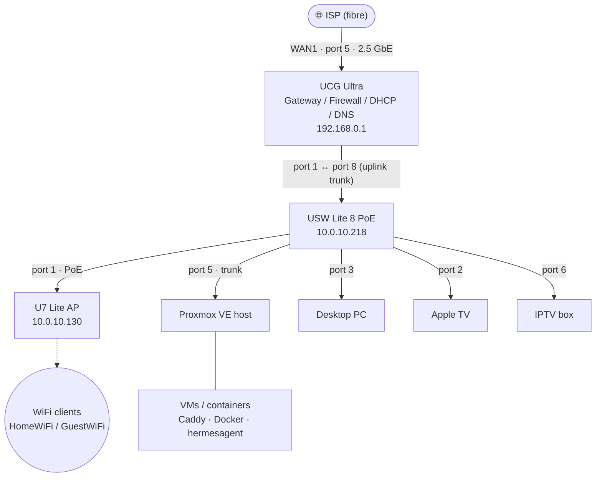
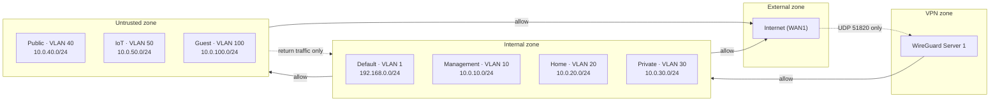

# Home Network & Homelab

A segmented home network on the Ubiquiti UniFi platform, with seven VLANs, a zone-based firewall and a Proxmox homelab.

> **Last updated:** 2026-11-17 · **UniFi Network:** 11.0.99 · **UniFi OS:** 6.0.17
> Change history: [CHANGELOG.md](CHANGELOG.md)

---

## At a glance

| | |
|---|---|
| **ISP** | Fibre ISP, DHCP on WAN1 (2.5 GbE) |
| **Gateway** | UniFi Cloud Gateway Ultra (UCG Ultra) |
| **Switching** | UniFi Switch Lite 8 PoE |
| **WiFi** | UniFi U7 Lite (WiFi 7, 2.4 + 5 GHz) |
| **Hypervisor** | Proxmox VE |
| **VLANs** | 7 (Default, Management, Home, Private, Public, IoT, Guest) |
| **Firewall** | UniFi Zone-Based Firewall: Internal / Untrusted / VPN / External |
| **Remote access** | WireGuard VPN |
| **Port forwards** | None |

## Physical topology

## Logical layout (VLANs & firewall zones)

## Features

- Seven VLANs across two firewall zones (Internal and Untrusted), plus a VPN zone
- Switch, AP and Proxmox host on a dedicated Management VLAN (10)
- Homelab services (Caddy, Docker) on the Private VLAN (30)
- No inbound port forwards; WireGuard VPN for remote access
- Untrusted zone blocked from Internal, the Gateway and other untrusted VLANs
- Client device isolation on the guest SSID
- SSH and Direct Remote Connection disabled

## Documentation

| Page | Contents |
|---|---|
| [Hardware](docs/hardware.md) | Devices, roles, IPs and port maps |
| [Networks & VLANs](docs/networks.md) | VLANs, subnets, network-wide settings, internal DNS |
| [Firewall & Zones](docs/firewall.md) | Zones, zone matrix, custom policies |
| [WiFi](docs/wifi.md) | SSIDs, security, radio settings |
| [Homelab](docs/homelab.md) | Proxmox host, VMs/containers, internal DNS |
| [Remote Access & Management](docs/remote-access.md) | WireGuard and console management settings |
| [Changelog](CHANGELOG.md) | Dated changes to the network |

---

Diagrams use [Mermaid](https://mermaid.js.org/) and render on GitHub, in VS Code (with a Mermaid preview extension) and in Obsidian.
