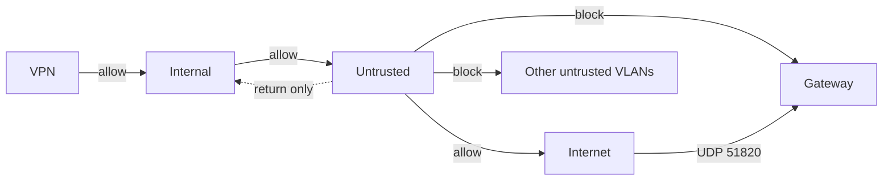

# Firewall & Zones

[← Back to overview](../README.md)

Firewall: UniFi **Zone-Based Firewall**. Policies apply between zones.

## Zone membership

| Zone | Networks / interfaces |
|---|---|
| Internal | Default, Management, Home, Private |
| Untrusted | Public, IoT, Guest |
| External | Internet 1 (WAN1), Internet 2 |
| Gateway | The UCG Ultra itself |
| VPN | WireGuard Server 1 |
| Hotspot | – |
| DMZ | – |

## Zone matrix

Rows are the **source** and columns the **destination**. "Return" means only replies to connections started from the other side are allowed.

| Source ↓ / Dest → | Internal | External | Gateway | VPN | Untrusted |
|---|---|---|---|---|---|
| **Internal** | ✅ Allow | ✅ Allow | ✅ Allow | ✅ Allow | ✅ Allow |
| **External** | ↩️ Return | ↩️ Return | ↩️ Return* | ↩️ Return | ↩️ Return |
| **Gateway** | ✅ Allow | ✅ Allow | – | ✅ Allow | ✅ Allow |
| **VPN** | ✅ Allow | ✅ Allow | ✅ Allow | ✅ Allow | ✅ Allow |
| **Untrusted** | ↩️ Return | ✅ Allow | ⛔ Block (custom) | ↩️ Return | ⛔ Block |

\* External → Gateway also allows WireGuard (UDP 51820), IPTV multicast/IGMP, and IPv6 control traffic (built-in).

## Custom policies

| Name | Action | Source | Destination |
|---|---|---|---|
| Allow All Traffic | Allow | Internal | Untrusted |
| Allow All Traffic | Allow | VPN | Untrusted |
| Block all Traffic | Block | Untrusted (Guest, IoT, Public) | Gateway |

## Port forwarding

None.

## NAT

Masquerade NAT from all VLANs to Internet 1 and Internet 2 (UniFi defaults).
