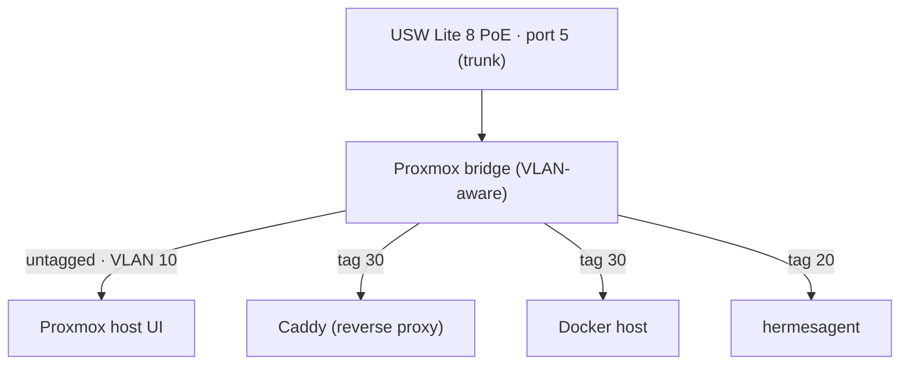

# Homelab

[← Back to overview](../README.md)

## Proxmox VE host

| | |
|---|---|
| Connection | USW Lite 8 PoE, port 5 (trunk) |
| Host management network | Management (VLAN 10) |
| VM networks | Home (20), Private (30) via VLAN tags on the Proxmox bridge |

## Services

| Name | Network | Role |
|---|---|---|
| Caddy (10.0.30.237, fixed) | Private (30) | Reverse proxy with automatic HTTPS for `*.example.ca` (Cloudflare DNS challenge) |
| Docker host | Private (30) | Container host for self-hosted apps |
| hermesagent | Home (20) | Agent service |

## Internal DNS

Wildcard A record `*.example.ca` on the UCG Ultra → Caddy.

## Reverse proxy routes

| Hostname | Backend | Access |
|---|---|---|
| `pm.example.ca` | Proxmox UI, `https://10.0.10.10:8006` | Admin Devices only (Caddy `remote_ip` match; others get 403) |
| `pi.example.ca` | `http://10.0.30.237:8080` | Any device allowed to reach Lab on TCP 443 |
