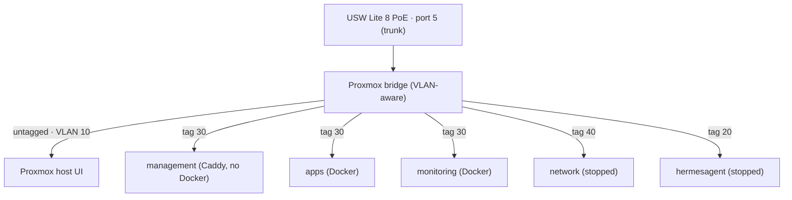

# Homelab

[← Back to overview](../README.md)

## Proxmox VE host

| | |
|---|---|
| Connection | USW Lite 8 PoE, port 5 (trunk) |
| Host management network | Management (VLAN 10) |
| VM networks | Home (20), Private (30), Public (40) via VLAN tags on the Proxmox bridge |

## Guests

| Name | Type | Network | IP | Resources |
|---|---|---|---|---|
| `management` | LXC (Debian 13, unprivileged, no Docker) | Private (30) | 10.0.30.4 (fixed) | 1 vCPU, 1 GB RAM, 8 GB disk |
| `apps` | VM (Debian 13, Docker) | Private (30) | 10.0.30.3 (fixed) | 4 GB RAM, 40 GB disk |
| `monitoring` | VM (Debian 13, Docker) | Private (30) | 10.0.30.2 (fixed) | 2 vCPU, 2 GB RAM, 30 GB disk |
| `network` | VM (stopped) | Public (40, DMZ) | 10.0.40.2 (fixed) | – |
| hermesagent | LXC (stopped) | Home (20) | DHCP | 4 GB RAM |

## Services

| Name | Host | Port | Role |
|---|---|---|---|
| Caddy (custom build with the Cloudflare DNS module, systemd service) | `management` | TCP 80, 443 | Reverse proxy for all apps; wildcard certificate for `*.example.ca` (Cloudflare DNS challenge) |
| oauth2-proxy v7.15.6 (systemd service) | `management` | 127.0.0.1:4180 | Pocket ID sign-in for Caddy (forward auth); Pocket ID client `oauth2-proxy` (PKCE) |
| Uptime Kuma (own login disabled; TCP 3001 accepts only 10.0.30.4, via a `DOCKER-USER` rule in the `kuma-firewall` service) | `monitoring` | TCP 3001 | Uptime monitoring; alerts to a private Discord channel. Monitors: NetBird (`nb.example.ca`, HTTPS), Pocket ID (`oidc.example.ca`, HTTPS), Caddy on `management` (10.0.30.4, TCP 443) |
| Beszel hub | `monitoring` | TCP 8090 | CPU, RAM and disk graphs; trusted-header sign-in (`X-Auth-Request-Email`, honoured only from 10.0.30.4) |
| Komodo Core, Periphery, MongoDB | `monitoring` | TCP 9120 (Core web UI) | Docker management; sign-in through Pocket ID on the cloud VPS (OIDC client `Komodo`, `admins` only), local login kept; web terminals disabled |
| Komodo Periphery | `apps` | – (connects out to Core directly at `http://10.0.30.2:9120`) | Docker agent; terminals and container exec disabled; working directory `/opt/komodo` |
| Beszel agent | Proxmox host, `monitoring`, `apps` | – | Reports host and container metrics to the hub |
| NetBird client `netbird-nb` (routing peer) | `apps` | – | Routes cloud NetBird traffic to 10.0.30.4 |

The monitoring web UIs are reached by name through Caddy on `management`, or directly by IP and port from Admin Devices.

## Internal DNS

See [Networks](networks.md) for the internal and public DNS records.

## Reverse proxy routes

Caddy on `management` (10.0.30.4). One site block per hostname; all use the wildcard certificate for `*.example.ca` (Cloudflare DNS challenge, set once in the global options). A snippet `pocket-id <groups>` adds Pocket ID sign-in through oauth2-proxy.

| Hostname | Backend | Access |
|---|---|---|
| `login.example.ca` | oauth2-proxy, `127.0.0.1:4180` | Sign-in page (Pocket ID) |
| `pm.example.ca` | Proxmox UI, `https://10.0.10.10:8006` | Admin Devices and the WireGuard subnet (192.168.2.0/24); others get 403 |
| `kuma.example.ca` | Uptime Kuma, `http://10.0.30.2:3001` | Pocket ID group `admins` (Kuma's own login is disabled) |
| `beszel.example.ca` | Beszel hub, `http://10.0.30.2:8090` | Pocket ID group `admins`; Beszel signs the user in from the forwarded email |
| `komodo.example.ca` | Komodo Core, `http://10.0.30.2:9120` | Pocket ID group `admins`, then Komodo's own Pocket ID login |
| any other name | – | 404 |
