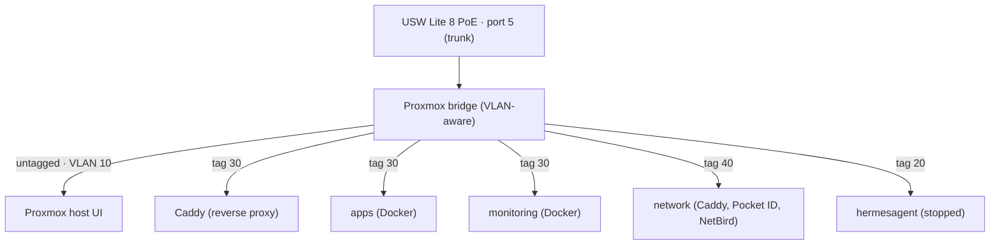

# Homelab

[← Back to overview](../README.md)

## Proxmox VE host

| | |
|---|---|
| Connection | USW Lite 8 PoE, port 5 (trunk) |
| Host management network | Management (VLAN 10) |
| VM networks | Home (20), Private (30), Public (40) via VLAN tags on the Proxmox bridge |

## Guests

| Name | Type | Network | IP | Resources |
|---|---|---|---|---|
| Caddy / Pi-hole | LXC | Private (30) | 10.0.30.237 (fixed) | 512 MB RAM |
| `apps` | VM (Debian 13, Docker) | Private (30) | 10.0.30.3 (fixed) | 4 GB RAM, 40 GB disk |
| `monitoring` | VM (Debian 13, Docker) | Private (30) | 10.0.30.2 (fixed) | 2 vCPU, 2 GB RAM, 30 GB disk |
| `network` | VM (Debian 13, Docker) | Public (40, DMZ) | 10.0.40.2 (fixed) | – |
| hermesagent | LXC (stopped) | Home (20) | DHCP | 4 GB RAM |

## Services

| Name | Host | Port | Role |
|---|---|---|---|
| Caddy | Caddy LXC | 80, 443 | Reverse proxy with automatic HTTPS for `*.example.ca` (Cloudflare DNS challenge) |
| Uptime Kuma | `monitoring` | TCP 3001 | Uptime monitoring |
| Beszel hub | `monitoring` | TCP 8090 | CPU, RAM and disk graphs |
| Komodo Core, Periphery, MongoDB | `monitoring` | TCP 9120 (Core web UI) | Docker management; web terminals disabled |
| Beszel agent | Proxmox host, `monitoring`, `apps` | – | Reports host and container metrics to the hub |
| Caddy (custom build with the Cloudflare DNS module) | `network` | TCP 80, 443 (443/udp not forwarded) | Reverse proxy with automatic HTTPS (DNS challenge) |
| Pocket ID v2 | `network` | 1411 (Docker network only) | Identity provider (passkeys) |
| NetBird server and dashboard | `network` | 80 (Docker network only), UDP 3478 | Self-hosted VPN control plane, relay and STUN |
| NetBird client (routing peer) | `apps` | – | Routes NetBird traffic to 10.0.30.3 |

The monitoring web UIs are reached directly by IP and port from Admin Devices.

## Internal DNS

See [Networks](networks.md) for the internal and public DNS records.

## Reverse proxy routes

Caddy on `network` (10.0.40.2), reached through the port forwards:

| Hostname | Backend | Access |
|---|---|---|
| `id.example.ca` | `pocket-id:1411` | Public |
| `vpn.example.ca` | NetBird server and dashboard (`netbird-server:80`, `netbird-dashboard:80`) | Public |

Caddy LXC (10.0.30.237):

| Hostname | Backend | Access |
|---|---|---|
| `pm.example.ca` | Proxmox UI, `https://10.0.10.10:8006` | Admin Devices only (Caddy `remote_ip` match; others get 403) |
| `pi.example.ca` | `http://10.0.30.237:8080` | Any device allowed to reach Lab on TCP 443 |
